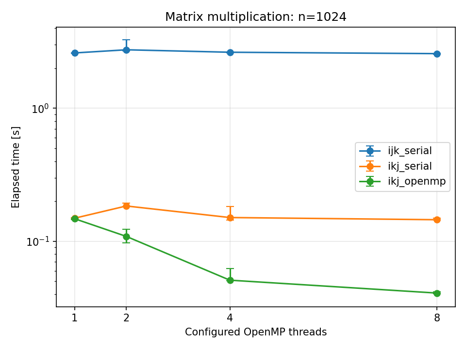
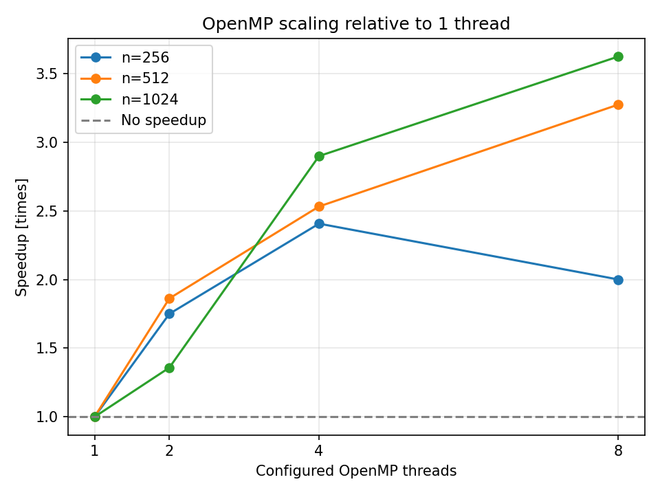
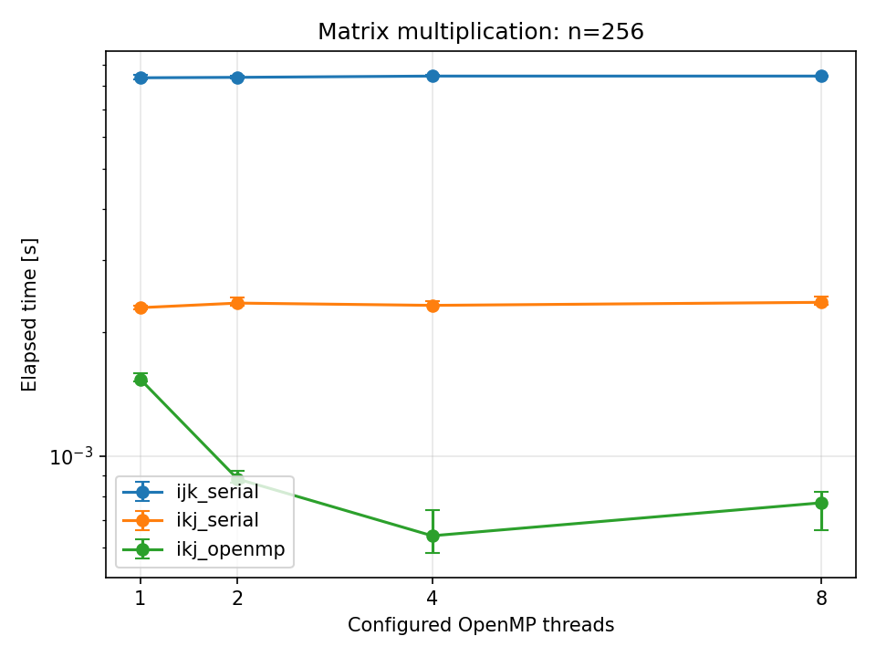
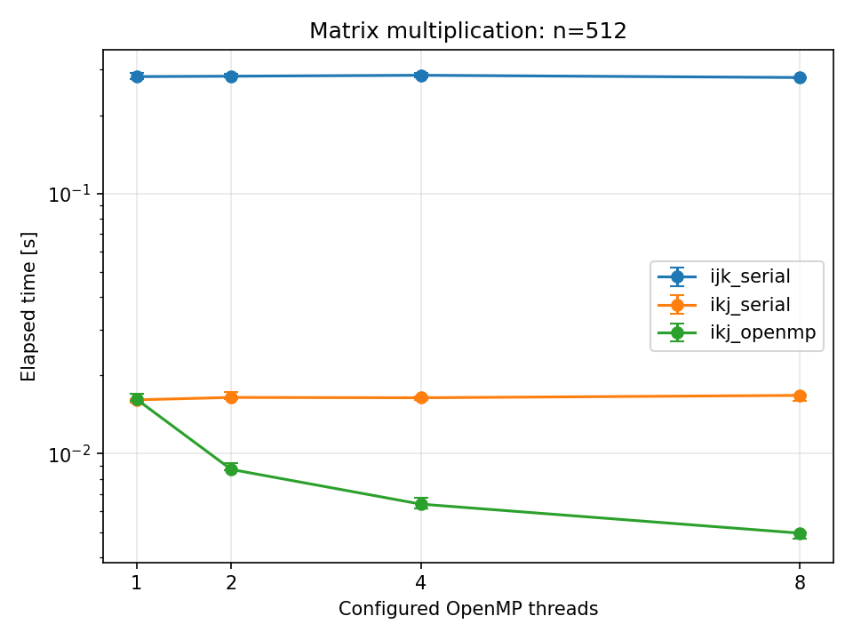
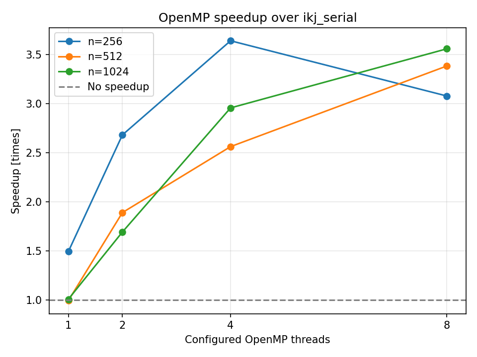

# OpenMP Matrix Multiplication Benchmark

CとOpenMPによる行列積の性能検証プロジェクトです。CPUキャッシュを意識したループ順序の変更と、OpenMPによる並列化が処理時間に与える影響を測定します。

3種類の実装を同じ入力で比較し、測定の自動化、CSVへの保存、Pythonによる集計・グラフ生成を行います。

## 現在の実装

`src/main.c` には次の3種類の行列積があります。

- `matmul_ijk_serial`: `i-j-k` 順の基準となる逐次実装
- `matmul_ikj_serial`: `i-k-j` 順へ変更した逐次実装
- `matmul_ikj_openmp`: `i-k-j` 順で、出力行列の初期化と外側の行ループをOpenMPで並列化した実装

## コードの由来

初期版のうち、自分で実装した部分は `mymatmul`（現在の `matmul_ikj_openmp` の原型）です。初期版の `matmul`、計測、結果比較、`main` などは授業で提供されたコードを基にしています。このリポジトリでは、実装の分離、計測・比較処理の改修、測定の自動化、集計・グラフ生成を追加しています。

## 必要な環境

- C11をコンパイルできるGCC
- OpenMP
- PythonとMatplotlib
- CMakeを使う場合はCMake 3.20以降とMinGW Makefilesに対応したビルドツール

## 測定環境

| 項目 | 内容 |
|---|---|
| CPU | 13th Gen Intel Core i7-1360P |
| 物理コア数／論理プロセッサ数 | 12／16 |
| OS | Windows 11 Home、バージョン10.0.26200、ビルド26200 |
| コンパイラ | MinGW-w64 GCC 14.2.0、x86_64-win32-seh |
| Python | 3.13.0 |
| Matplotlib | 3.9.2 |
| 電源 | AC電源接続、電源モード「バランス」 |
| 時計 | `omp_get_wtime()`、`omp_get_wtick()` の報告値は0.001秒 |

再測定時は電源設定を固定し、重いバックグラウンド処理が落ち着いてから実行します。測定中は他の操作や別のベンチマークの同時実行を避けます。

## ビルド

PowerShellでリポジトリのルートから実行します。

測定に使用したGCCの直接ビルド方法です。

```powershell
New-Item -ItemType Directory -Force build | Out-Null
gcc -std=c11 -Wall -Wextra -Wpedantic -O3 -march=native -fopenmp `
    src\main.c -o build\matmul_benchmark.exe
```

CMakeからビルドする場合は次を実行します。

```powershell
cmake -S . -B build -G "MinGW Makefiles" -DCMAKE_BUILD_TYPE=Release
cmake --build build
```

`-O3` はコンパイラ最適化、`-march=native` はビルドしたCPU向けの命令生成、`-fopenmp` はOpenMPを有効にします。異なるCPUで測定する場合は、その環境で再ビルドしてください。

WindowsのMinGW Makefilesは、日本語を含むパスで `Illegal byte sequence` になる場合があります。その場合は、リポジトリを `C:\dev\openmp-matmul-benchmark` など英数字だけのパスにcloneしてビルドしてください。

## 測定・集計の実行

Pythonの依存ライブラリをインストールします。

```powershell
python -m pip install matplotlib==3.9.2
```

全条件の測定と集計・グラフ生成を順に実行します。

```powershell
python .\scripts\run_benchmarks.py
python .\scripts\plot_results.py
```

各スクリプトは自身の場所からプロジェクトのルートを求めます。出力先の既存ファイルは上書きされるため、以前の測定と比較する場合は事前に退避してください。

| 出力 | 内容 |
|---|---|
| `results/raw_results.csv` | 180件の生データ |
| `results/summary.csv` | 36条件の測定回数、時間の中央値・最小値・最大値、GFLOPS |
| `results/speedup.csv` | 12条件の高速化率 |
| `results/execution_time_*.png` | 各行列サイズの実行時間（縦軸は対数）、誤差棒は最小値～最大値 |
| `results/openmp_speedup.png` | `ikj_serial` を基準とするOpenMP版の高速化率 |
| `results/openmp_scaling.png` | OpenMP版自身の1スレッド実行を基準とする高速化率 |

### 単一条件の実行

引数に正方行列の一辺の要素数を指定します。

```powershell
$env:OMP_NUM_THREADS = "4"
$env:OMP_DYNAMIC = "FALSE"
.\build\matmul_benchmark.exe 256
```

標準出力にはヘッダーなしのCSVを出力します。列順は次のとおりです。

```text
trial,implementation,matrix_size,configured_threads,seconds,gflops
```

診断情報は標準エラー出力へ送ります。比較に失敗すると非ゼロの終了コードを返し、Python側は結果を保存せず停止します。

## 測定方法

- 対象は行優先の1次元配列に格納した、倍精度浮動小数点数の正方行列です。
- 行列サイズは256、512、1024、設定スレッド数は1、2、4、8です。
- 各プロセスで `srand(0)` を使い、`rand()` から `[0, 1)` の入力行列A・Bを生成します。同一実行環境では各条件で同じ入力を使います。乱数列はCライブラリが異なる環境間で一致するとは限りません。
- 入力生成・メモリ確保後、各実装を1回ずつウォームアップします。
- 各条件で5組の測定を行い、各組で3実装の実行順を巡回させます。順序は `ijk→ikj→OpenMP`、`ikj→OpenMP→ijk`、`OpenMP→ijk→ikj` の繰り返しです。5組では各順序の回数は完全には均等になりません。
- 時計の分解能の影響を減らすため、1組の測定で同じ行列積を複数回実行し、合計時間を実行回数で割ります。

| 行列サイズ | 1組内の実行回数 |
|---|---:|
| 256 | 100 |
| 512 | 20 |
| 1024 | 5 |

各実装は呼び出しごとに出力を上書きまたは初期化します。`ikj` 版の出力初期化とOpenMPの並列領域の開始・終了は計測に含み、メモリ確保、入力生成、比較、CSV出力は含みません。同じ入力・出力領域を繰り返し利用する測定です。

`seconds` は各組の1回あたりの平均時間です。その5値の中央値を代表値とし、最小値・最大値も保存します。誤差棒はこの5値の観測範囲であり、信頼区間ではありません。GFLOPSは `2 × n³ / seconds / 10⁹` とし、集計では中央値の時間から再計算します。

Python側は `OMP_NUM_THREADS` を条件ごとに設定し、`OMP_DYNAMIC=FALSE` を指定します。`configured_threads` は `omp_get_max_threads()` による設定値であり、実際に参加したスレッド数の実測値ではありません。逐次版はこの列の値によらず逐次実行です。測定順は行列サイズ、設定スレッド数ともに昇順です。

集計時は全36条件の存在、各条件の試行番号1～5が各1回であること、時間が有限かつ正であることを検査します。

### 計算結果の比較

全測定の後、`ikj_serial` と `ikj_openmp` の最終出力を `ijk_serial` と要素ごとに比較します。非有限値は不合格とし、各要素について次を満たすか判定します。

```text
|actual - reference| <= 1e-12 + 1e-8 × |reference|
```

絶対許容誤差により基準値0の要素も判定できます。この比較は基準実装との一致を確認するもので、独立した数学的な正解との比較ではありません。

## 高速化率の定義

`T_ijk(n,p)`、`T_ikj(n,p)`、`T_omp(n,p)` を、行列サイズ `n`・設定スレッド数 `p` の条件で測定した各実装の代表時間とします。逐次版の `p` は測定条件の識別であり、逐次版が `p` スレッドを使う意味ではありません。

| CSV列 | 定義 | 比較する効果 |
|---|---|---|
| `order_speedup` | `T_ijk(n,p) / T_ikj(n,p)` | ループ順序の変更 |
| `openmp_speedup` | `T_ikj(n,p) / T_omp(n,p)` | 同じループ順の逐次版からOpenMP版への変更 |
| `total_speedup` | `T_ijk(n,p) / T_omp(n,p)` | 基準実装からの全体の改善 |
| `thread_scaling_speedup` | `T_omp(n,1) / T_omp(n,p)` | OpenMP版自身のスレッド数による伸び |

いずれも中央値同士の比であり、各試行の比の中央値ではありません。1より大きければ基準より高速、1未満なら低速です。`openmp_speedup` の1スレッド値は必ずしも1になりません。`thread_scaling_speedup` の1スレッド値は定義上1です。

## 結果と限界

掲載グラフは再測定結果です。比較に使用した[初回の測定結果](results/run_01/)も保存しています。

| 行列サイズ | ループ順序変更（全設定条件の範囲） | 逐次ikj版→OpenMP版（8スレッド） | OpenMP版の1→8スレッド |
|---|---:|---:|---:|
| 256 | 3.55～3.63倍 | 3.08倍 | 2.00倍 |
| 512 | 16.65～17.47倍 | 3.38倍 | 3.27倍 |
| 1024 | 14.93～17.72倍 | 3.56倍 | 3.62倍 |



`ikj` 順では、最内側ループで行列BとCの連続した要素にアクセスするため、キャッシュライン内のデータを続けて利用できます。また、行列Aの同じ要素を内側ループで再利用します。これらが高速化に寄与したと考えられます。今回の測定範囲では、行列サイズが大きいほどループ順序変更による改善率が概ね大きくなる傾向が見られました。ただし、512と1024の差は小さく、一部の条件では逆転しています。キャッシュの利用効率だけでなく、コンパイラによる自動ベクトル化なども影響し得ます。



OpenMP版自身を基準とすると、512・1024では8スレッドまで実行時間が短縮しました。256では4スレッドで約2.41倍、8スレッドで約2.00倍となり、8スレッドへの増加で低速化しました。初回測定では256も8スレッドまで高速化したため、この部分は実行間で変動しています。両測定とも8スレッド時の高速化率は256、512、1024の順に大きくなりました。小さい行列では、計算時間に対する並列処理の管理・同期の相対的な負担が大きいことが、この傾向の一因と考えられます。

<details>
<summary>補助グラフと初回・再測定の比較</summary>





| 行列サイズ | 初回の1→2／4／8スレッドの高速化率 | 再測定の1→2／4／8スレッドの高速化率 |
|---|---|---|
| 256 | 1.77／2.31／2.62倍 | 1.75／2.41／2.00倍 |
| 512 | 1.80／2.62／3.36倍 | 1.86／2.53／3.27倍 |
| 1024 | 2.03／3.23／3.95倍 | 1.36／2.90／3.62倍 |

1024の2スレッド実行は初回に約2倍となりましたが、再測定では約1.36倍でした。したがって、2スレッドでほぼ2倍になるとは一般化しません。並列化による短縮は確認できる一方、高速化率の細部には実行間の変動があります。

</details>

1024でも8スレッドでの高速化率は約3.62倍で、理想的な8倍には達していません。並列処理の管理・同期や、共有するキャッシュ・メモリ帯域の競合などが、比例した高速化を妨げた可能性があります。

### 検証の限界

- 測定は1台のPCで行っており、異なるCPU・OS・コンパイラ環境でも同じ高速化率になるとは限りません。
- 実行時間のみを測定しており、キャッシュミス、自動ベクトル化、同期、メモリ帯域など、各要因の寄与は直接確認していません。上記の原因に関する説明は、コードの構造と観測結果に基づく推測です。
- サイズ256では、1スレッドのOpenMP版が逐次ikj版より高速になる傾向が、独立した2回の測定で観測されました（約1.36倍・1.49倍）。一方、512・1024では両実装の時間はほぼ同等でした。このサイズ依存の差の原因は特定していません。複数スレッドへの分担による効果と区別するため、OpenMP版自身の1スレッド実行を基準とした高速化率も示しています。
- 同じ入力行列と出力領域を繰り返し利用しているため、キャッシュ再利用の影響を含みます。初めて使う行列を1回だけ計算する処理とは条件が異なります。

ブロッキングやGPU化は本プロジェクトの必須範囲には含めません。

